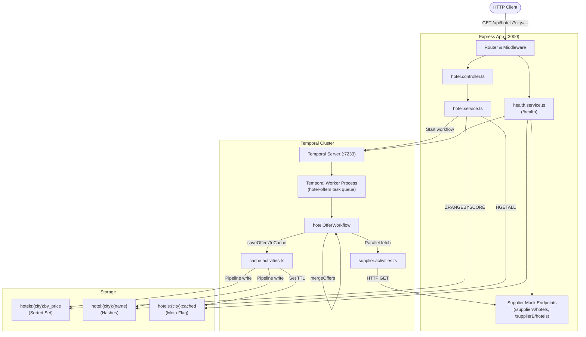

# Hotel Offer Orchestrator

Hotel Offer Orchestrator aggregates hotel offers from multiple supplier APIs in parallel, deduplicates overlapping hotels, and caches the results in Redis. It uses Temporal workflows for distributed orchestration and Redis sorted sets for price range queries. When one supplier is down, the service returns partial results with a short cache TTL and warning headers.

## Architecture



## Tech Stack

- Runtime: Node.js 22 LTS
- Language: TypeScript (strict mode, no any)
- Web Framework: Express 5
- Workflow Engine: Temporal.io TypeScript SDK
- Datastore & Cache: Redis 7 (ioredis)
- Validation: Zod
- Logging: Pino
- Test Runner: Node.js built-in test runner (node:test)

## Quick Start with Docker

Clone the repository and enter the directory:

```bash
cd hotel-offer-orchestrator
docker compose up --build -d
docker compose ps
docker compose logs -f app worker
```

Services exposed:
- Express API: http://localhost:3000
- Health Check: http://localhost:3000/health
- Temporal Web UI: http://localhost:8080

To stop services:
```bash
docker compose down
```

## Running Locally Without Docker

To run the app and worker on your host while running Redis and Temporal in Docker:

1. Start backing services:
   ```bash
   docker compose up -d temporal redis
   ```
   The Temporal Web UI is served by the temporal container at http://localhost:8080.

2. Setup environment variables:
   ```bash
   cd Backend
   cp .env.example .env
   ```

3. Install dependencies:
   ```bash
   npm install
   ```

4. Start the Temporal worker:
   ```bash
   npm run worker:dev
   ```

5. In another terminal, start the Express API:
   ```bash
   npm run dev
   ```

## API Reference

### 1. GET /api/hotels
Retrieves, merges, and filters hotel offers for a city.

Query Parameters:
- city (string, required): City name (e.g. delhi, mumbai). Case-insensitive and trimmed.
- minPrice (number, optional): Minimum price threshold.
- maxPrice (number, optional): Maximum price threshold.

Headers:
- X-Request-Id: Request UUID generated per request.
- X-Supplier-Warnings: Set when one supplier was unreachable.

Example Request:
```bash
curl "http://localhost:3000/api/hotels?city=delhi&minPrice=2000&maxPrice=4500"
```

Example Response (200 OK):
```json
[
  {
    "name": "Blue Horizon Inn",
    "price": 2200,
    "supplier": "Supplier A",
    "commissionPct": 10
  },
  {
    "name": "Sunset Retreat",
    "price": 2950,
    "supplier": "Supplier B",
    "commissionPct": 9
  },
  {
    "name": "Radison",
    "price": 3200,
    "supplier": "Supplier A",
    "commissionPct": 11
  },
  {
    "name": "The Grand Palace",
    "price": 4200,
    "supplier": "Supplier B",
    "commissionPct": 11
  }
]
```

### 2. GET /health (or GET /api/health)
Checks connectivity to Redis, Temporal, and supplier endpoints. Times out individual dependency checks after 3 seconds so the endpoint always responds quickly.

Example Request:
```bash
curl http://localhost:3000/health
```

Example Response (200 OK):
```json
{
  "status": "ok",
  "redis": { "status": "ok" },
  "temporal": { "status": "ok" },
  "supplierA": { "status": "ok", "latencyMs": 2 },
  "supplierB": { "status": "ok", "latencyMs": 2 },
  "timestamp": "2026-11-22T14:30:00.000Z"
}
```

### 3. Supplier Mock Endpoints
- GET /supplierA/hotels?city=delhi
- GET /supplierB/hotels?city=delhi

Returns raw mock data with hotelId, name, price, city, and commissionPct.

### Error Responses
All errors return JSON with a standard shape:
```json
{
  "message": "Validation failed",
  "details": {
    "minPrice": ["minPrice cannot be greater than maxPrice"]
  }
}
```

- 400 Bad Request: Missing city query param, negative prices, or minPrice > maxPrice.
- 503 Service Unavailable: Both suppliers down, or Redis/Temporal unreachable.
- 500 Internal Server Error: Unhandled application errors.

## How the Temporal Workflow Works

The workflow file is Backend/src/temporal/workflows/hotelOffer.workflow.ts.

1. Parallel Execution: Uses Promise.allSettled to call fetchSupplierAOffers(city) and fetchSupplierBOffers(city) at the same time.
2. Activity Retries: Activities use exponential backoff (up to 3 attempts, starting at 1s interval).
3. Partial Failure Tolerance: If one supplier fails, the workflow proceeds with offers from the healthy supplier and records a warning (Supplier X unavailable).
4. Complete Failure Handling: If both suppliers fail, the workflow raises a non-retryable ApplicationFailure("All suppliers unavailable"), which the Express error handler translates to a 503 response.
5. Deterministic Deduplication: Merges offers with mergeOffers():
   - Cheaper price wins.
   - On equal price, lower commission percentage wins.
   - On equal commission, Supplier A wins.
   - Results are sorted by price ascending, tie-breaking by hotel name alphabetically.
6. Cache Write: Calls saveOffersToCache activity. If warnings are present, a shorter partial TTL is passed.

## Redis Data Model & Price Filtering

Rather than serializing an entire array into one Redis string and filtering with JavaScript in memory, data is stored in three key types:

1. Price Index (Sorted Set): hotels:{city}:by_price
   - Score: price (number)
   - Member: normalizedName (string)
2. Hotel Data Hashes: hotel:{city}:{normalizedName}
   - Fields: name, price, supplier, commissionPct
3. Cache Meta Key: hotels:{city}:cached
   - Set to "1" with an expiration time.

### Why a Sorted Set is Used
Redis Sorted Sets index members by score using an internal skip list and hash table. Running ZRANGEBYSCORE hotels:{city}:by_price min max gives an O(log N + M) lookup in Redis, where N is the number of hotels in the city and M is the number of items in range. The service only fetches hashes for the matching hotels via a pipeline, avoiding full-array deserialization and filtering in Node.js.

## Testing

### 1. Unit Tests
Runs the deterministic offer merging and sorting tests using the built-in Node test runner:
```bash
cd Backend
npm test
```

### 2. Postman Collection
The collection is in postman/hotel-offer-orchestrator.postman_collection.json (v2.1 format) with variable baseUrl (default http://localhost:3000).

Folders included:
1. Health: Checks system status and dependency fields.
2. Hotels: Delhi happy path (overlaps, deduplication, price order) and Mumbai happy path.
3. Price filtering: Range filter (minPrice and maxPrice), min only, max only.
4. Edge cases: Unknown city (city=atlantis), invalid price bounds (minPrice > maxPrice), missing city param.
5. Suppliers: Direct calls to raw mock supplier endpoints.
6. Outage simulation: Tests degradation behavior when Supplier A is offline.

### 3. Simulating a Supplier Outage

#### Linux / macOS
```bash
SUPPLIER_A_DOWN=true docker compose up -d app worker
```

#### Windows PowerShell
```powershell
$env:SUPPLIER_A_DOWN="true"; docker compose up -d app worker
```

Run the requests in Postman folder 6:
- GET /supplierA/hotels?city=delhi returns 503.
- GET /api/hotels?city=delhi returns 200 with header X-Supplier-Warnings: Supplier A unavailable and only Supplier B offers.
- GET /health returns 200 with status "degraded".

Reset back to normal:
- Linux / macOS: `SUPPLIER_A_DOWN=false docker compose up -d app worker`
- Windows PowerShell: `$env:SUPPLIER_A_DOWN="false"; docker compose up -d app worker`

## Design Decisions & Trade-Offs

1. Unfiltered Searches Refresh Cache:
   GET /api/hotels?city=delhi (no price filter) always triggers the workflow to fetch current rates from suppliers and refresh Redis.
2. Filtered Searches Query Redis:
   GET /api/hotels?city=delhi&minPrice=... checks if the city exists in Redis. If cached, it queries Redis directly via ZRANGEBYSCORE. If not cached, it runs the workflow first to populate Redis.
3. Short TTL for Partial Results:
   Normal cache TTL is 300 seconds (CACHE_TTL_SECONDS). If one supplier was down, caching partial data for 5 minutes would hide newly recovered rates. Partial results use PARTIAL_CACHE_TTL_SECONDS (30 seconds).
4. Debian Base Image Over Alpine:
   Temporal's TypeScript SDK uses native bindings compiled against standard glibc. Using node:22-slim avoids runtime issues with Alpine's musl libc.
5. Bounded Health Checks:
   Pings to Redis and Temporal use a 3-second timeout. If a service becomes unresponsive, /health still returns in under 4 seconds.

## Troubleshooting

- Requests to /api/hotels hang:
  Check if the worker is running: docker compose ps. If the worker container stopped or crashed, workflows sit queued in Temporal waiting for a poller.
- Port Conflicts:
  Default ports: 3000 (API), 7233 (Temporal gRPC), 8080 (Temporal UI), 6379 (Redis). Verify other local services are not using these ports.
- Temporal Startup:
  Temporal starts in dev mode and initializes its default namespace. The container healthcheck will stay in starting state until ready (10-15s). Other services wait for service_healthy.

## Known Limitations

- Temporal Down Timeout: If Temporal is completely down when an unfiltered search arrives, Express will wait for the client connection and workflow dispatch attempt before failing, which can take approximately 20 seconds before returning a 503 response.
- Dev Mode Persistence: Temporal runs in dev mode, so workflow history is lost when its container is recreated.
